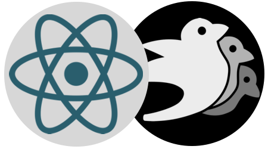
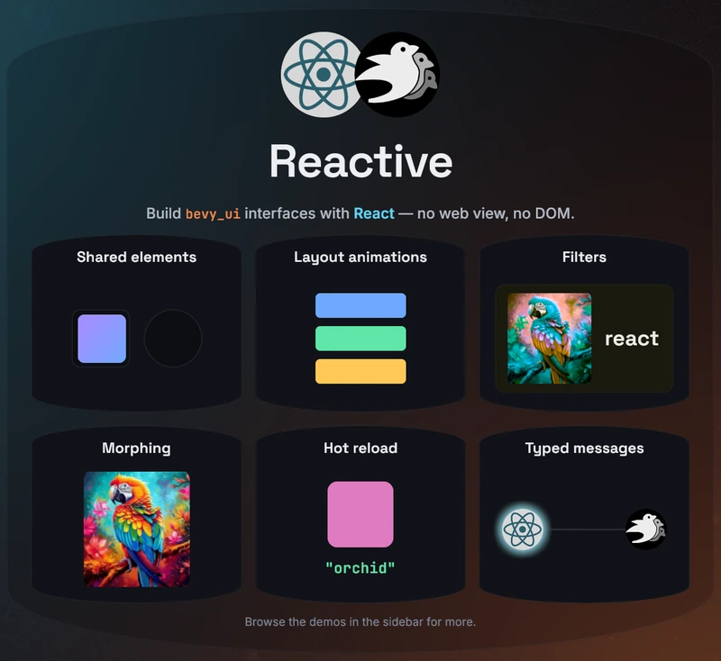
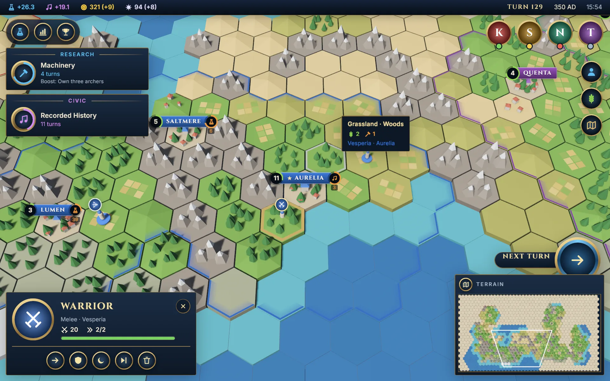
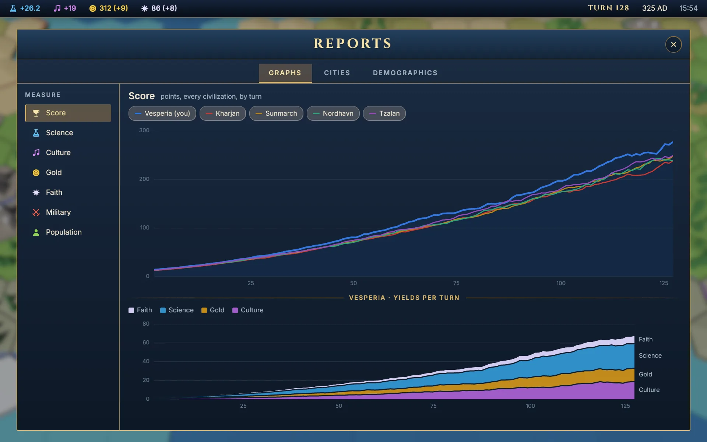
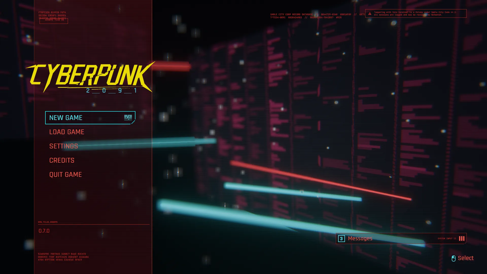
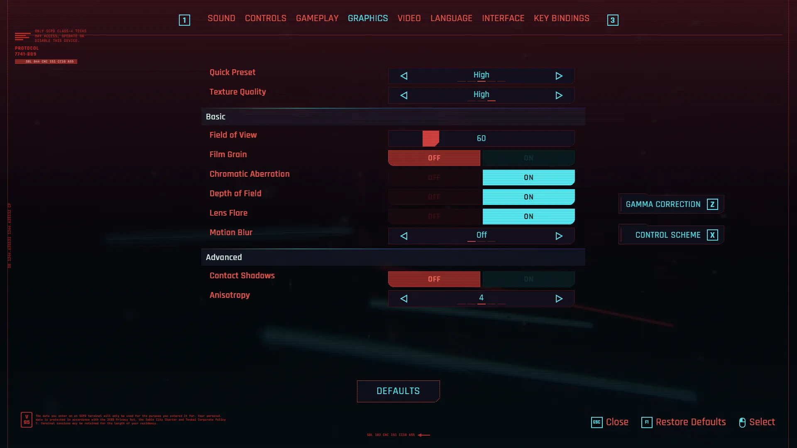

<p align="center">
  
</p>

<h1 align="center">bevy-react</h1>

<p align="center">
  <a href="https://github.com/tulustul/bevy-react/actions/workflows/ci.yml"></a>
  <a href="https://crates.io/crates/bevy-react"></a>
  <a href="https://www.npmjs.com/package/bevy-react"></a>
  <a href="https://docs.rs/bevy-react"></a>
  <a href="#bevy-compatibility"></a>
  <a href="#license"></a>
</p>

Build [`bevy_ui`](https://docs.rs/bevy/latest/bevy/ui/index.html) interfaces with
**React**. You write components in React/TSX and they render to native Bevy UI
through a **React Native-style bridge** - **no web view, no DOM**. The JS side stays
purely declarative; Rust and Bevy do the heavy lifting. State and interactions flow
both ways between your Bevy app and React, and edits hot-reload live while keeping
component state.

**[Documentation](https://tulustul.github.io/bevy-react/)** ·
**[Live demo](https://tulustul.github.io/bevy-react/demo/)** (the web build of the
demos gallery, running in your browser)



```tsx
import { mount } from "bevy-react";
import { useState } from "react";

function App() {
  const [n, setN] = useState(0);
  return (
    <node style={{ padding: 20, gap: 12, flexDirection: "column" }}>
      <text>{`Count: ${n}`}</text>
      <button
        onClick={() => setN((c) => c + 1)}
        style={{ backgroundColor: "#7aa2f7" }}
      >
        <text>+</text>
      </button>
    </node>
  );
}

mount(<App />);
```

That's a real component - `<node>` and `<button>` render to actual `bevy_ui`
nodes, `useState` works as you'd expect, and saving the file updates the running
app without losing the count.

## Showcase

The following examples are not playable games but only a UI demonstrations:

[**Civilization**](https://github.com/tulustul/bevy-react/tree/main/examples/civilization)
recreates the interface of a 4X strategy game over a generated hex world: city
banners and unit flags pinned to the 3D map, a minimap filmed by a second
camera, a city screen, a technology tree, and reports with history graphs for
every civilization.
[Play it in your browser](https://tulustul.github.io/bevy-react/civilization/).




[**Cyberpunk**](https://github.com/tulustul/bevy-react/tree/main/examples/cyberpunk)
is a homage to the front end of a famous open-world RPG: the title screen,
the main menu, a six-step character creation, saves, eight tabs of settings
that really change the camera, the window and the sound, and the pause
menu over your lifepath's world. Every screen is React and glitches into the
next through a custom morph shader.
[Play it in your browser](https://tulustul.github.io/bevy-react/cyberpunk/).




[**Coldwake**](https://github.com/tulustul/bevy-react/tree/main/examples/coldwake)
is a homage to the diegetic interface of a sci-fi horror game inspired by Dead Space: there is no
HUD. The engineer's health runs down his spine, the ammo count floats over
his gun, and the suit menu, the store, the upgrade bench and the hack panel
are holograms in the room — every one a React `<surface>`. You walk him
around the deck: panels wake as he comes near, and F locks the camera on
the one he faces and makes the mouse its cursor.
[Play it in your browser](https://tulustul.github.io/bevy-react/coldwake/).


[**Synth**](https://github.com/tulustul/bevy-react/tree/main/examples/synth)
is a node graph editor for a modular synth you can hear: drag cables between
sockets and they snap, whip and glow, cards pop in and lean as you drag
them, and the whole patch plays, blinking and pulsing in time. Bevy draws
the cables under the UI, following the sockets React lays out, keeps the
text crisp at every zoom, and runs the synth on the audio thread.
[Play it in your browser](https://tulustul.github.io/bevy-react/synth/).


## Getting started

```sh
cargo add bevy-react
npx bevy-react init ui
cd ui && npm install && npm run watch
```

```rust
use bevy::prelude::*;
use bevy_react::prelude::*;

fn main() {
    App::new()
        .add_plugins(DefaultPlugins)
        // Loads `ui/dist/app.js` and `ui/dist/vendor.js`.
        .add_plugins(ReactPlugins)
        .add_systems(Startup, |mut commands: Commands| {
            commands.spawn(Camera2d);
        })
        .run();
}
```

The [Getting started](https://tulustul.github.io/bevy-react/getting-started/)
guide covers configuration, cargo features, and the typed client.

React runs on an embedded V8 by default. For a binary ~48 MB smaller, use
QuickJS instead (`--no-default-features --features quickjs,…`), see
[JS engines](https://tulustul.github.io/bevy-react/tooling/js-engines/).

## Bevy compatibility

| bevy | bevy-react |
| ---- | ---------- |
| 0.20 | 0.8        |
| 0.19 | 0.1 – 0.7  |

## License

Dual-licensed under either of
[Apache License 2.0](https://github.com/tulustul/bevy-react/blob/main/LICENSE-APACHE)
or [MIT license](https://github.com/tulustul/bevy-react/blob/main/LICENSE-MIT), at
your option.
